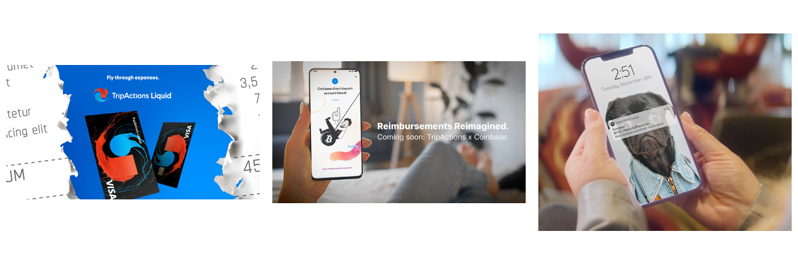
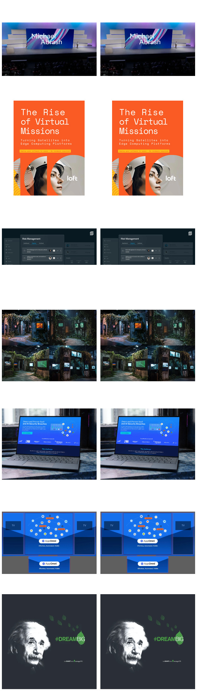
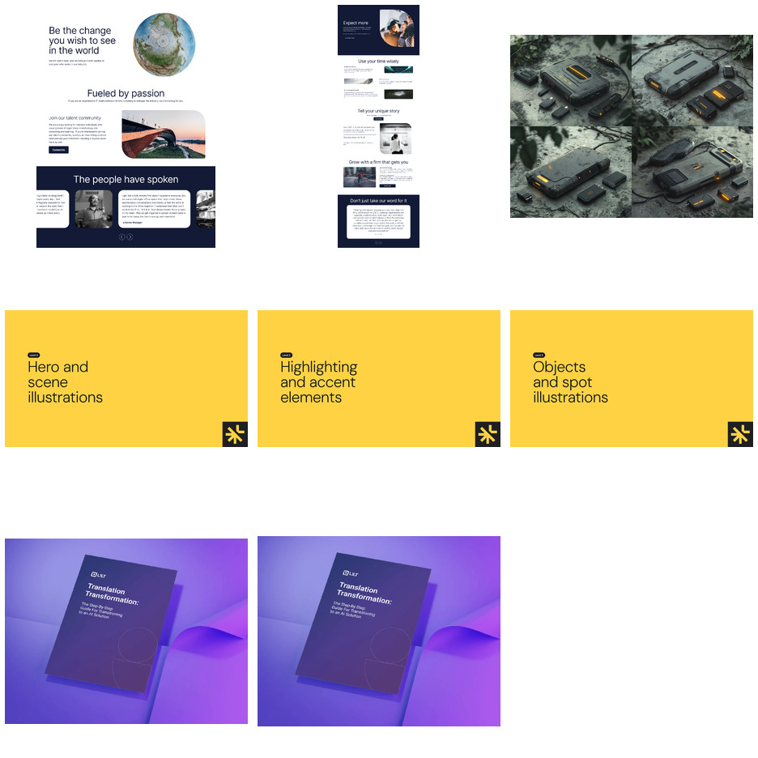
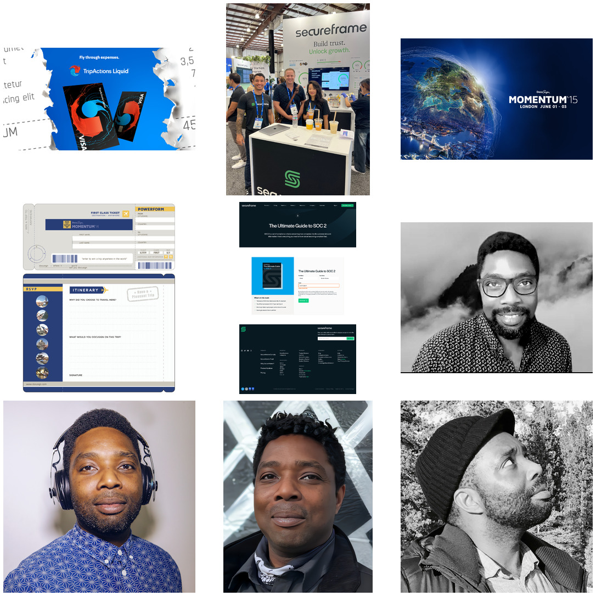
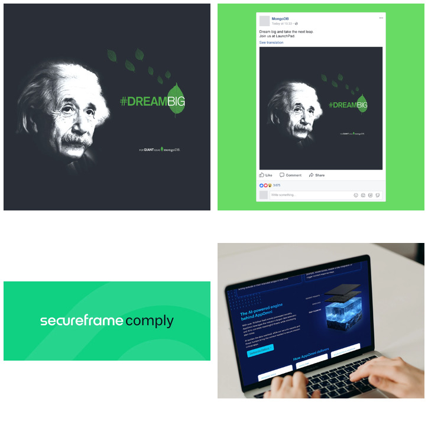
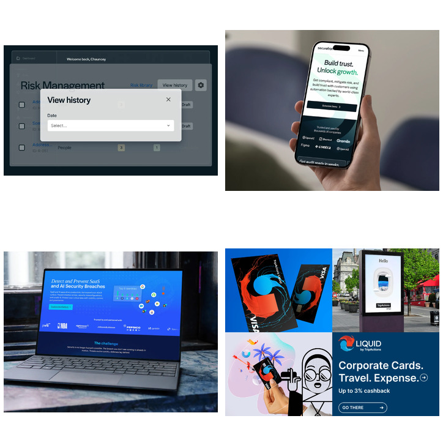

# Contact sheets — Phase 1 asset curation review

Images referenced here live in `docs/review/images/` on this branch only, per instruction — they are not committed to any production media folder and should not be merged into `site/public/media`.

## 1. External embeds and possible local matches

| Current filename | Source | Proposed project | Confidence | Recommended action |
|---|---|---|---|---|
| (Adobe CCV embed `KFgp954czdh`) | Adobe Behance CCV player (external, unreachable from this environment) | Visa (`visa.json`) | Cannot verify — network-blocked | Cannot confirm whether this embed shows the same footage as the candidate below. |
| `ad-tripactions-01.png` | `no1owns/web-portfolio` → `images/navan/ads/ad-tripactions-01.png` | Visa (`visa.json`) | Visually confirmed (viewed directly) | **Strong candidate.** Shows actual TripActions Liquid VISA-branded physical card photography — the only asset found anywhere that matches the page's own overview text ("custom photography featuring the physical expense card"). The 9 images currently on `/visa` show generic flight-notification video stills with no card or Visa branding visible at all. |
| `55e4da7f11803f7b.webp` (existing) | Currently on `/visa` | Visa (`visa.json`) | Visually confirmed (viewed directly) | Shown for comparison — a TripActions-notification phone mockup, no Visa branding. |

**Lyft embed** (`SMIcP4zAIjK`): no comparison image — `no1owns/web-portfolio` has no `lyft` folder at all. No local source found in any audited repository.

## 2. Duplicate and near-duplicate groups

| Pair | Match type | Where referenced | Recommended action |
|---|---|---|---|
| `meta-connect-08.webp` / `meta-connect-13.webp` | Exact byte-identical | Both in `meta-connect.json`, two different gallery slots | Keep one, repoint the other reference or replace with a genuinely different frame |
| `loft/a26ee5114fc51d56.webp` / `loft/dd0a597a18f778d5.webp` | Exact byte-identical | Both in `loft.json` | Same as above |
| `secureframe/c03ba1ee832d46a7.webp` / `secureframe/ae04082dbcfe7f8f.webp` | Visually identical (different compression) | Both in `secureframe.json` + `brand-systems-and-web-performance.json` | Keep one canonical copy |
| `appomni/2cb5c1f1d975e47d.webp` / `appomni-events/appomni-booth-environmental-design.webp` | Visually identical | The booth photo sits, generically alt-tagged, inside the big homepage/product-screenshot gallery *and* correctly as the AppOmni Events hero | Remove the generic-gallery copy; keep the correctly-placed AppOmni Events copy |
| `appomni/bcdba867f901e846.webp` / `appomni/appomni-website-hero-render.webp` | Visually identical | Both inside the same AppOmni gallery | Keep one canonical copy |
| `appomni/db4bd94345c9938d.webp` / `appomni-events/appomni-black-hat-usa-2026-graphic.webp` | Visually identical | The Black Hat USA 2026 graphic sits generically inside the product-screenshot gallery *and* correctly on AppOmni Events | Remove the generic-gallery copy |
| `mongodb/dream-big/72d52c2ee3a05a1b.webp` / `c32f9a74e8b4120f.webp` | Visually identical (Einstein #DreamBig graphic) | Already resolved in the prior content-corrections pass — `c32f9a74e8b4120f.webp` removed from `dream-big.json`, file left on disk | Already fixed; shown here for the ledger's completeness |

## 3. Uncertain company or project attribution

| Current filename | Source | Proposed project | Confidence | Recommended action |
|---|---|---|---|---|
| `web-modernassurance-01.png` through `-07.png` | `web-portfolio/images/secureframe/` | Unknown — not Secureframe | **Not Secureframe.** Shows an unrelated company's generic careers page, no Secureframe branding anywhere | Exclude from any Secureframe import; flag to Ayo — likely misfiled, may belong to a different past client with no current case-study page |
| `event-appomni-06.png` | `web-portfolio/images/appomni/` | AppOmni Events? | Uncertain — no AppOmni branding visible | Exclude unless Ayo confirms attribution; reads as generic dystopian concept art, filed under "events" but not clearly event photography |
| `linx/8c12341c6fb944c7.webp`, `7b8b27509ca4bd5c.webp`, `fdd8d1a7a32e5d02.webp` | Already in `linx-security.json` | Linx | Programmatic near-duplicate flag (dHash distance 3–4), not individually visually re-confirmed in this pass | Quick manual check recommended — these are deck title-slide images from the same Linx deck, so visual similarity may be expected rather than a true duplicate |
| `lilt/5205eeeda5fad9a7.webp`, `5914a1fa2f4e84b8.webp` | Already in `lilt-ebook.json` | Lilt | Programmatic near-duplicate flag (dHash distance 4) | Quick manual check recommended |

## 4. Proposed additions from `web-portfolio`

| Current filename | Source | Proposed project | Confidence | Recommended action |
|---|---|---|---|---|
| `ad-tripactions-01.png` | `navan/ads/` | Visa | Visually confirmed | See §1 above — strong candidate |
| `event-secureframe-01.PNG` | `secureframe/` | Secureframe (new event representation) | Visually confirmed | Real conference booth photo; Secureframe currently has zero event/environmental representation anywhere on the site |
| `event-docusign-00023.jpg` | `docusign/events/` | DocuSign Momentum | Visually confirmed | "Momentum '15, London" key art — a different regional instance of the same year already represented (SF). Needs Ayo's call on scope |
| `campaign-docusign-01.png` | `docusign/ads/` | DocuSign Momentum | Visually confirmed | Momentum '14 direct-mail piece — an earlier year than what's currently shown. Needs Ayo's call on scope |
| `web-secureframe-01.png` | `secureframe/` | Secureframe | Visually confirmed | "Ultimate Guide to SOC 2" ebook landing page — optional, lower priority than hero/product shots |
| `ayo/*` (4 files) | `ayo/` | About / Resume | Not yet reviewed in depth | Personal/headshot photography not tied to any single case study — relevant to the About page, not a project gallery |

## 5. Assets recommended for removal from rendered galleries

| Current filename | Page | Why | Status |
|---|---|---|---|
| `mongodb/dream-big/c32f9a74e8b4120f.webp` | was `dream-big.json` | Duplicate Einstein campaign graphic | **Already removed** in the prior content-corrections pass; file left on disk, unreferenced |
| `mongodb/dream-big/11a9284397ff494a.webp` | was `dream-big.json` | Facebook-post screenshot of the same graphic (Einstein appeared twice) | **Already removed**; file left on disk, unreferenced |
| `secureframe/fc8eb9ad2dc493b6.webp` (representative sample) | `brand-systems-and-web-performance.json` **and** `collections/secureframe.json` | One of ~49 images/videos referenced from *both* the legacy project page and the Secureframe collection page | Not removed — structural question, see `docs/security-brand-experiences-followup.md` |
| `appomni/1922e3c3d25f2de0.webp` (representative sample) | `brand-systems-and-web-performance.json` **and** `collections/appomni.json` | One of ~48 images/videos referenced from *both* pages | Same as above |

The last two rows are representative samples of a much larger pattern — see "The Security Brand Experiences overlap, quantified" in `docs/media-curation-audit.md`.

## 6. Meaningless filenames proposed for descriptive renaming

| Current filename | Shows | Proposed canonical name |
|---|---|---|
| `secureframe/73210c14a4911ab5.webp` | Secureframe compliance dashboard, "View history" dialog over a Risk Management table | `secureframe-dashboard-risk-management-view-history.webp` |
| `secureframe/fcdc5ac39f59eeb4.webp` | Hand holding a phone showing the Secureframe mobile homepage | `secureframe-mobile-homepage-hero.webp` |
| `appomni/appomni-website-hero-render.webp` | Already descriptive — kept as-is | *(no change)* |
| `navan/tripactions/b9a12ff730241ab2.webp` | Performance Marketing Systems cover collage | `tripactions-cover-collage.webp` |

This is a representative sample. The full proposed-name formula and remaining ~300 hash-named files are in `docs/media-asset-ledger.csv` (`proposed_canonical_path` column) and the naming convention is specified in `docs/media-migration-plan.md`.
